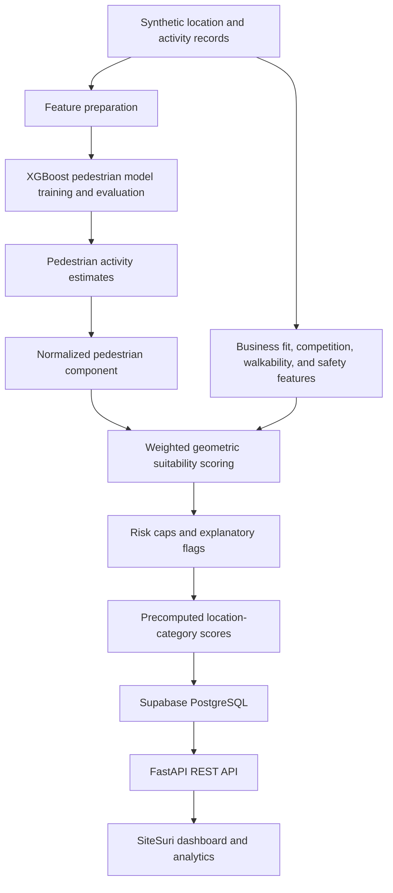
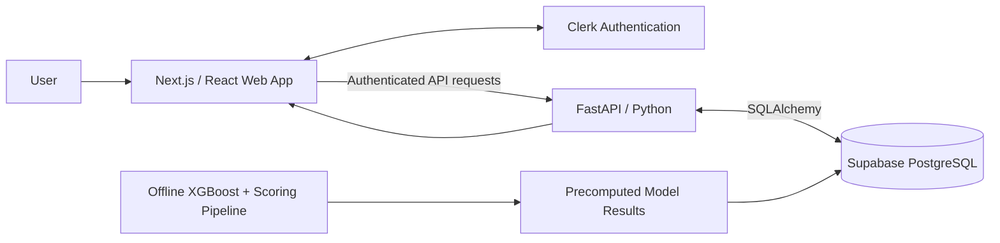

# SiteSuri

**Smarter Locations. Better Business Decisions.**

SiteSuri is a web-based geospatial decision-support platform built for **CSSprint 2026**. It helps Filipino micro, small, and medium enterprises (MSMEs) and aspiring entrepreneurs explore candidate business locations, evaluate category-specific suitability, and compare nearby alternatives through an interactive map and explainable analytics.

The platform brings geographic exploration, an experimental pedestrian-activity model, and a transparent multi-factor scoring methodology into one application. Users can investigate **where** to consider establishing a business and **why** a candidate location receives its suitability score.

| Project | Details |
| --- | --- |
| Event | CSSprint 2026 Hackathon |
| Domain | Geospatial analytics · Business intelligence · Decision support |
| Audience | Filipino MSMEs and aspiring entrepreneurs |
| Application | Next.js frontend · FastAPI backend · Supabase PostgreSQL |

## Features

### Interactive Location Explorer

- Explore candidate locations on a map with geographic search and point selection.
- Set a search radius of **250 m, 500 m, 1 km, or 2 km**.
- Assess locations for **food stalls**, **sari-sari stores**, or **general retail**.
- View candidate suitability scores and expand cards for scoring details and model flags.
- Open **Full Analysis** for a candidate, carrying its location, search radius, and selected business category into Area Analytics.
- Bookmark locations for continued research and comparison.

### Area Analytics

Analyze and compare candidate locations within a selected geographic radius using five views:

1. **Suitability Distribution** — distribution of nearby candidates' suitability scores.
2. **Distance vs. Suitability** — the relationship between distance from the search center and suitability.
3. **Top Candidate Locations** — rankings for the selected business category.
4. **Business Category Comparison** — suitability of a selected candidate across the three supported categories.
5. **Suitability Component Breakdown** — the individual factors behind a selected candidate's score.

Area Analytics also summarizes the candidates found and the availability of their scoring results.

### Saved Locations and Personal Analytics

- Save and manage bookmarked candidate locations in the authenticated workspace.
- Revisit candidates without repeating the initial map search.
- Use **My Locations Analytics** to compare saved candidates and examine rankings across business categories.

### Authentication and Account Management

- Clerk-powered account registration and sign-in.
- Authenticated application access and user-profile synchronization through FastAPI.
- User accounts, saved locations, and analysis-related records stored in Supabase PostgreSQL.

## Suitability Scoring and Machine Learning

SiteSuri uses a **hybrid machine-learning and rule-based scoring pipeline**. The ML component estimates pedestrian activity; the overall suitability score combines that estimate with location characteristics and business-specific scoring rules.

### Pedestrian Activity Model

The offline Python pipeline prepares time-dependent and geographic features, trains an **XGBoost regressor with a Poisson count objective**, and evaluates the resulting predictions.

Model inputs include the hour and day, weekend/payday indicators, rainfall, location type, nearby establishments, transport accessibility, and population density. The target is the estimated **pedestrian count per hour**.

The implementation includes chronological evaluation, spatial/location holdouts, comparisons against simple baselines, and regression metrics including MAE, RMSE, WAPE, and site-level ranking correlation. Predictions are averaged over a reference operating schedule and normalized into a pedestrian-activity component score.

### Five Scoring Components

| Component | Weight | What it represents |
| --- | ---: | --- |
| Predicted pedestrian activity | 30% | Normalized pedestrian activity estimated by XGBoost |
| Business fit | 20% | Match between nearby establishments and a category-specific reference mix |
| Competition suitability | 20% | Category-specific assessment of nearby competitor counts |
| Walkability | 15% | Sidewalk, paved-surface, and crossing indicators |
| Safety and hazard | 15% | Flood, seismic, crime, lighting, and emergency-access indicators |

The five components are combined using a **weighted geometric mean**, with scoring floors, risk-based caps, and explanatory flags. Scoring is performed for each supported business category, allowing the same candidate to receive different category-specific assessments.

### Scoring Workflow



**Data methodology:** The current scoring dataset consists of synthetic location and pedestrian-activity records, and the resulting scores represent experimental model outputs. The application retrieves **precomputed suitability results** when users explore or compare locations; XGBoost is not retrained on each dashboard request.

## Technology Stack

| Layer | Technologies | Responsibility |
| --- | --- | --- |
| Frontend | **Next.js (App Router), React, TypeScript** | Application interface, navigation, and interactive views |
| Styling and UI | **Tailwind CSS, Lucide icons** | Responsive styling and interface components |
| Mapping | **MapLibre GL JS** | Interactive geographic visualization |
| Charts | **Recharts** | Suitability distribution, comparisons, and analytics |
| Authentication | **Clerk** | Registration, login, and session identity |
| Backend | **Python, FastAPI, Pydantic** | REST APIs, validation, and access control |
| Database access | **SQLAlchemy** | Relational models and database operations |
| Database | **Supabase PostgreSQL** | Users, candidate locations, scores, and saved locations |
| Frontend data | **Axios, TanStack Query** | Authenticated requests, fetching, caching, and mutations |
| Machine learning | **XGBoost, scikit-learn** | Pedestrian count regression and model evaluation |
| Data processing | **pandas, NumPy** | Dataset generation, transformations, and numerical scoring |
| Containerization | **Docker** | Backend service packaging and reproducible environments |
| Deployment | **Vercel** | Hosted web application and API |
| Collaboration | **Git, GitHub** | Source control and project integration |

## System Architecture

SiteSuri separates its client application, authenticated API, relational data, and offline model computation.



**Application flow:** Clerk handles sign-in and session identity. The frontend communicates with FastAPI using authenticated API requests; FastAPI reads and writes application records in PostgreSQL. Location Explorer and Analytics display stored, category-specific scores produced by the offline scoring pipeline.

Docker is included in the backend toolchain for containerized packaging; the web application's deployment and the offline model workflow remain distinct concerns.

## Repository Structure

```text
sitesuri/
├── apps/
│   ├── web/                 # Next.js application
│   └── api/                 # FastAPI REST backend
├── ml/                      # Data processing and scoring pipeline
├── supabase/                # Database schemas and migrations
├── docs/                    # Project documentation
└── README.md
```

## Local Development

### Prerequisites

- Node.js and npm
- Python and pip
- Git
- Docker for container-based backend workflows
- Clerk credentials and a configured Supabase PostgreSQL database

### Clone the Repository

```bash
git clone https://github.com/averageCoder-bit/sitesuri.git
cd sitesuri
```

### Start the Backend

From the repository root:

```bash
cd apps/api
python -m venv .venv
```

Activate the virtual environment, then install dependencies:

**Windows PowerShell:**

```powershell
.\.venv\Scripts\Activate.ps1
pip install -r requirements.txt
```

**macOS / Linux:**

```bash
source .venv/bin/activate
pip install -r requirements.txt
```

Configure the backend environment with the Supabase database connection, Clerk verification credentials, and allowed frontend origins. Then run:

```bash
uvicorn app.main:app --reload --host 127.0.0.1 --port 8000
```

API documentation is available at `http://127.0.0.1:8000/docs` while the backend is running.

### Start the Frontend

In another terminal, from the repository root:

```bash
cd apps/web
npm install
npm run dev
```

Open **http://localhost:3000**. Configure `apps/web/.env.local` with the Clerk frontend credentials and `NEXT_PUBLIC_API_URL` pointing to the running FastAPI service. Mapping and geographic search configuration should match the environment used for the project.

Database schema changes are managed through the SQL files in `supabase/`.

**Security:** Keep database connection strings, Clerk secret keys, and other credentials in local environment variables or the deployment platform's secret configuration. Do not commit `.env` or `.env.local` files.

## Development and Collaboration

SiteSuri is maintained in a GitHub monorepo, with the **`main`** branch used for integrated project releases and submission. Work on the frontend, backend, and machine-learning components is brought together through Git-based integration and testing.

## Acknowledgments

Developed for **CSSprint 2026 Hackathon** to explore how geospatial analytics, explainable scoring, and machine learning can support more informed business-location decisions for Filipino MSMEs.

---

**SiteSuri — Smarter Locations. Better Business Decisions.**
